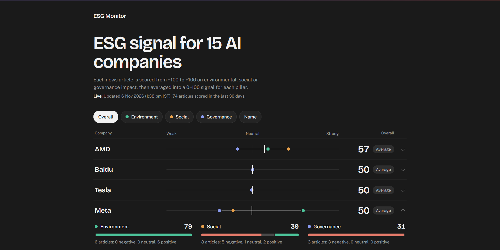
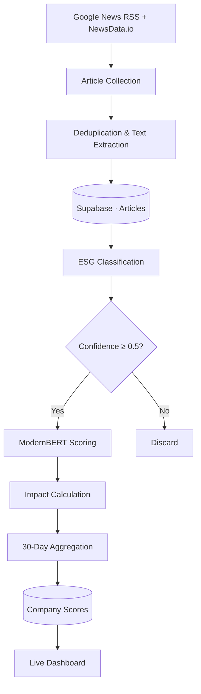

# Conducto

<div align="center">

### Tracking the ESG signals behind Big Tech.

A news-driven ESG monitoring system for 15 major technology companies.  
Collects, filters and analyses news to surface Environmental, Social and Governance signals.

<br/>

<a href="https://aeonioo.github.io/Conducto/" style="color:#E6B450;"><b>Live Dashboard ↗</b></a>
 ·
<a href="https://www.kaggle.com/datasets/aeonio/esg-final" style="color:#E6B450;"><b>Dataset ↗</b></a>
 ·
<a href="https://github.com/aeonioo/Conducto" style="color:#E6B450;"><b>Source Code ↗</b></a>

<br/>


<br/>




</div>


## Overview

ESG Monitor tracks ESG-related news across 15 major technology companies:

NVIDIA · Microsoft · Google · Meta · OpenAI · Amazon · Anthropic · Apple · Tesla · IBM · AMD · Oracle · Intel · Baidu · Alibaba

Articles are classified and scored based on their ESG aspect, relevance and sentiment to generate rolling 30-day company scores across Environmental, Social and Governance pillars.

## Why Conducto?

Unlike ESG tools that rely on external LLM APIs for every article, Conducto uses a two-stage, locally run ML pipeline:

- **TF-IDF + Logistic Regression** filters irrelevant news *(1.3ms)*
- **Fine-tuned ModernBERT** scores relevant articles for ESG aspect, relevance and sentiment.

<p align="center">
  
</p>

Both models achieved **9/9 agreement** with the hand-labeled results. Conducto completed inference in approximately **0.4s per article**, compared to **1.0s** for Gemini, around **2.5× faster**, without external LLM API calls.

## How it Works

The system runs through three automated workflows, with GitHub Actions handling orchestration and Supabase managing storage.


### Workflows

| Workflow | Schedule | Responsibility |
|---|---|---|
| `scrape-news` | Every 4 hours | Collects news and extracts article text |
| `pipeline-score` | After successful scraping | Classifies, scores and updates company signals |
| `cleanup-30d` | Daily | Removes articles older than 30 days |

### Processing Pipeline

1. **Collection**: Google News RSS + NewsData.io, deduplication and article extraction via `trafilatura`.
2. **ESG Filtering**: TF-IDF + Logistic Regression classifies articles as `E`, `S`, `G` or `NOT_ESG` (confidence ≥ 0.5).
3. **ModernBERT Scoring**: Predicts ESG aspect, relevance and sentiment.
4. **Aggregation**: Converts predictions into rolling 30-day company scores.

## Scoring

Articles are scored from **-100 to +100** based on relevance and sentiment, then aggregated into 30-day E, S and G scores.

- **Overall score:** Average of E, S and G.
- **Strong:** ≥ 60
- **Average:** 40–59
- **Weak:** < 40

Scores start at a neutral baseline of **50**, with low article volumes weighted towards 50.

## Technology

| Layer | Implementation |
|---|---|
| News collection | Google News RSS, NewsData.io |
| Text extraction | Trafilatura |
| ESG classification | TF-IDF, Logistic Regression |
| Multi-task scoring | ModernBERT, PyTorch |
| ML tooling | Scikit-learn, Transformers |
| Database | Supabase / PostgreSQL |
| Automation | GitHub Actions |
| Model hosting | Hugging Face Hub |
| Dashboard | HTML, CSS, JavaScript |
| Deployment | GitHub Pages |

## 05 / Project Structure

```text
conducto/
│
├── .github/
│   └── workflows/
│       ├── scrape.yml
│       ├── pipeline.yml
│       └── cleanup.yml
│
├── data collection/
│   ├── news_scraper.py
│   ├── pipeline.py
│   ├── scoreboard.py
│   ├── train_model.py
│   ├── requirements.txt
│   └── requirements-pipeline.txt
│
├── docs/
│   └── index.html
│
└── dataset/
    └── labeling and dataset scripts (local)
```

Trained model files, encoders, `.env` and dataset CSVs are kept outside the public repository.

## Getting Started

### Prerequisites
Python 3.13 · Supabase · Hugging Face token · NewsData.io API key (optional)

### 1. Database
Create a Supabase project and run the database schema in its SQL Editor.

### 2. Models
Upload the ESG classifier files and CPU-compatible ModernBERT model to your private Hugging Face repository: `YOUR_USERNAME/esg-models`.

### 3. GitHub Secrets

Add all .env keys including HF_READ_TOKEN under **Settings → Secrets and variables → Actions**:

### 4. Deploy

Run the workflows manually from the GitHub Actions; they run automatically tho!

### 5. Dashboard

Configure `docs/index.html`:

```javascript
const CONFIG = {
  SUPABASE_URL: "https://xxxx.supabase.co",
  SUPABASE_ANON_KEY: "your_anon_key"
};
```

## Dataset

### Tech Company News Labeled for ESG

The labeled news dataset developed alongside this project is published on Kaggle.

<a href="https://www.kaggle.com/datasets/aeonio/esg-final" style="color:#E6B450;"><b>Explore the dataset ↗</b></a>

It supports the ESG classification stage of the pipeline.

Article titles and text remain the property of their original publishers and are used for research/learning purposes. 

---

*ESG Monitor measures signals from news coverage, not independently verified ESG performance. Scores can be influenced by media coverage, sentiment and article volume.*

---
<div align="center">

MIT License · 2026

</div>

